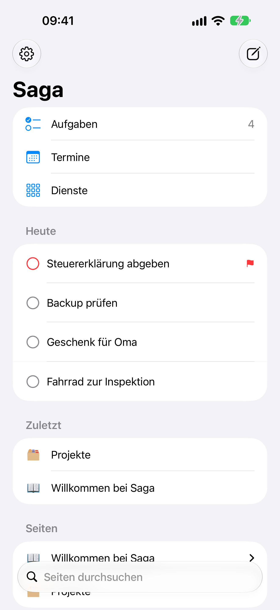
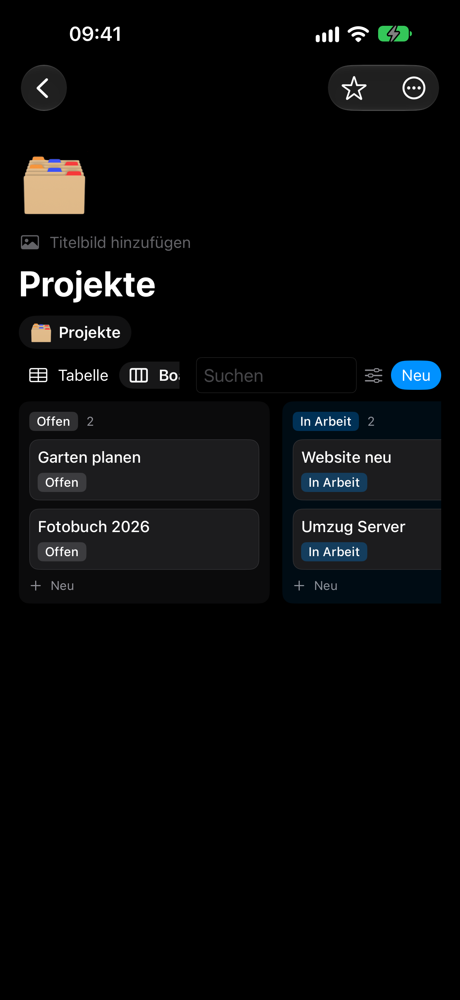
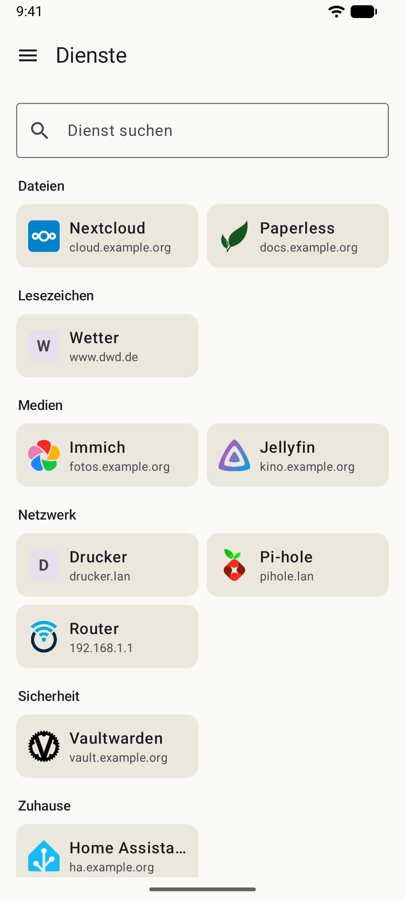
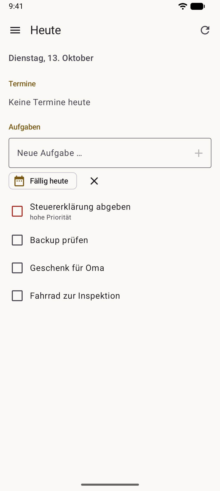
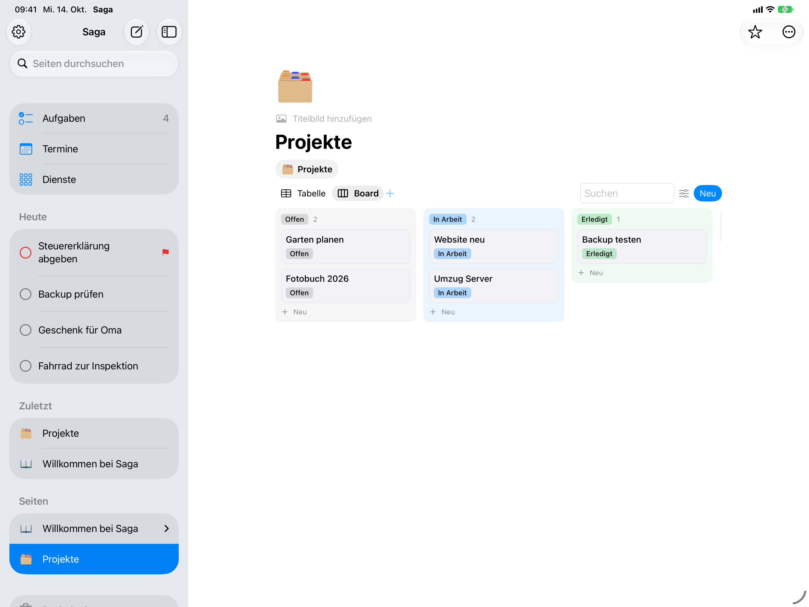

  

<h1 align="center">Saga Apps</h1>

  Native Apps für <a href="https://github.com/yggdrasil-sh/saga/blob/main/README.de.md">Saga</a> – dein selbst gehostetes Zuhause für Dienste, Notizen und Aufgaben. 
  iPhone · iPad · Mac · Linux (GNOME) · Android

  <a href="README.md">English</a> · <b>Deutsch</b> · <a href="README.es.md">Español</a>

---

Die Apps verbinden sich mit deinem eigenen Saga-Server. Seiten, Datenbanken, Aufgaben und Termine werden
**nativ** angezeigt und bearbeitet – keine eingebettete Webseite. Sie folgen der Systemsprache: Deutsch,
Englisch oder Spanisch (alle anderen Sprachen: Englisch).

| Plattform | Technik | Ordner | Anleitung |
|---|---|---|---|
| iOS, iPadOS, macOS | SwiftUI, WidgetKit | [`ios/`](ios/) | [ios/README.md](ios/README.md) |
| Linux (GNOME) | Python, GTK4 + libadwaita, RPM | [`linux/`](linux/) | [linux/README.md](linux/README.md) |
| Android | Kotlin, Jetpack Compose | [`android/`](android/) | [android/README.md](android/README.md) |

## So sieht es aus

  
  
  
  

  

## Herunterladen

Fertige Pakete gibt es unter [Releases](https://github.com/yggdrasil-sh/saga-apps/releases/latest):

| System | Datei |
|---|---|
| macOS 26 oder neuer | `Saga-<Version>-macOS.dmg` – signiert und von Apple beglaubigt |
| Linux (Fedora, AlmaLinux/RHEL 10 mit EPEL) | `saga-<Version>-1.noarch.rpm` |
| Linux (jede Distribution mit Flatpak) | `saga-<Version>-x86_64.flatpak` (`flatpak install --user saga-….flatpak`) |
| Android 8 oder neuer | `Saga-<Version>.apk` (Installation aus unbekannten Quellen erlauben) |

iPhone und iPad: selbst bauen (siehe [ios/README.md](ios/README.md)) – für den App Store gibt es noch keine Version.

## Anmelden

1. Saga-Server eintragen (z. B. `https://saga.example.org`) und **Anmelden** – die Anmeldung öffnet sich im Browser
   (lokales Konto, LDAP oder SSO, je nach Server).
2. Oder bequemer: im Browser in Saga oben auf 👤 → **Einstellungen** → **Apps & Geräte** → **App per QR-Code anmelden**
   und den Code mit der App scannen (Mac/Linux: Kopplungslink einfügen).

Die Apps bleiben danach dauerhaft angemeldet. Abmelden lässt sich jedes Gerät jederzeit in Saga unter
„Apps & Geräte“.

## Selbst bauen

Persönliche Einstellungen (Entwickler-Team, App-ID, Testgeräte, Verteil-Befehle) stehen **nie** im Repository,
sondern in lokalen Dateien, die git ignoriert. Vorlagen liegen jeweils daneben:

- `ios/Config/Local.xcconfig.example` → `ios/Config/Local.xcconfig`
- `ios/Config/local.env.example` → `ios/Config/local.env`
- `tools/local.env.example` → `tools/local.env` (Rechner für die Linux-Tests)

Version aller Apps setzen: `tools/set-version.sh 1.2.0` (eine Quelle: `VERSION`). Landet die Änderung an
`VERSION` auf `main`, baut GitHub alle Pakete und veröffentlicht sie als Release (`.github/workflows/release.yml`).
Neues landet zuerst auf dem Branch `testing`: Jeder Push dort baut alle Pakete als Probelauf (ohne Release).

## Versionen

Die Apps folgen [Semantic Versioning](https://semver.org/lang/de/). Sie zeigen in den Einstellungen ihre eigene
Version und die des Servers; ist eine App für den Server zu alt, weist sie darauf hin.

## Lizenz

[GNU AGPL-3.0](LICENSE) – wie Saga selbst.
